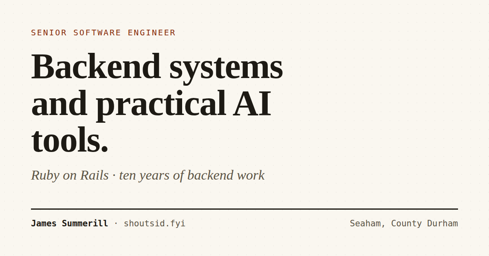

<div align="center">

# shoutsid.fyi

**The portfolio site for James Summerill — Ruby on Rails, backend systems, and practical AI.**

A content-driven Sinatra application with no database and no write path, shipped as a pinned,
unprivileged, read-only container and published through a Cloudflare Tunnel.

[Live site](https://shoutsid.fyi) · [Documentation](docs/README.md) · [Architecture](docs/architecture.md) · [Deployment](docs/deployment.md)

[](https://www.ruby-lang.org/)
[](https://sinatrarb.com/)
[](https://www.docker.com/)
[](https://rspec.info/)
[](LICENSE)

</div>



## Contents

- [Overview](#overview)
- [Design principles](#design-principles)
- [Features](#features)
- [Tech stack](#tech-stack)
- [Quick start](#quick-start)
- [Local development](#local-development)
- [Project structure](#project-structure)
- [Content model](#content-model)
- [Testing and verification](#testing-and-verification)
- [Deployment](#deployment)
- [Security](#security)
- [Documentation](#documentation)
- [Contributing](#contributing)
- [License](#license)
- [Acknowledgements](#acknowledgements)

## Overview

`shoutsid.fyi` is a personal portfolio and engineering blog. It presents project
case studies, an experience history, a printable CV, and short posts on backend
engineering and systems design.

The site is deliberately small in surface area and strict in what it claims:

- **No database, no sessions, no write path.** Every page is rendered from
  YAML and Markdown committed to this repository.
- **Content is data.** Project cards, case studies and page copy all read from
  `config/*.yml`; templates render records rather than carry claims of their
  own.
- **Claims are evidence-based.** Each project carries a status, and a figure,
  demo or benchmark has to be reproducible. The rules are in
  [`docs/editorial.md`](docs/editorial.md).
- **The runtime is hardened by default.** The production container runs
  unprivileged, with a read-only root filesystem, all capabilities dropped, and
  no inbound port exposed to the network.

This repository is **source-available, not open source**. It is published so the
implementation and its claims can be inspected. See [License](#license).

## Design principles

| Principle | How it shows up in the code |
|---|---|
| **One source of truth** | A project is defined once in `config/projects.yml`; the homepage, `/work` and its case-study page all render the same record. |
| **Fail at boot, not in a card** | `lib/content.rb` validates every status, slug, section, link and figure file before the app serves a request. |
| **Content over markup** | Page prose lives in `config/pages.yml` and is rendered through `page_copy`; a template carrying its own prose fails the suite. |
| **Reproducible runtime** | Base images are pinned by digest, gems are locked, and the same test commands work on a host Ruby or in the dev container. |
| **Verify the claim, not the status code** | `bin/site verify` checks page content, `bin/site links` checks external URLs, and `/healthz` reads the same content store the pages do. |
| **The gate is one command** | `bin/site check` runs the linter and the full suite together, against the working tree. |

## Features

- **Content-driven pages** — homepage, About, Work index, project case studies,
  blog, contact and a generated CV, all from one content store.
- **Project case studies** — status badges, stack lists, highlights, optional
  screenshots/diagrams, and a documented `demo` block containing a command and
  the output it actually produced.
- **Markdown blog** — YAML front matter, reading time, tags, drafts, an Atom
  feed at `/blog/feed.xml`, and per-post metadata.
- **Generated CV** — the same experience, projects, toolkit and education as
  the rest of the site, laid out to print or save as PDF.
- **SEO and machine-readable output** — canonical URLs, Open Graph metadata,
  `sitemap.xml`, `robots.txt` and an [`llms.txt`](public/llms.txt) summary for
  automated readers.
- **Digest-versioned assets** — CSS and JavaScript URLs carry the file digest
  and are served with a one-year immutable policy; generated pages revalidate.
- **Strict security headers** — a restrictive CSP, `nosniff`, `DENY` framing,
  a referrer policy and a permissions policy on every generated page.
- **Operational tooling** — one CLI for build, run, deploy, tunnel management,
  health, HTTP verification and external link checking.

## Tech stack

| Layer | Choice |
|---|---|
| Language | Ruby 3.3.12 |
| Web framework | Sinatra 4.1 (`Sinatra::Base`) |
| Application server | Puma 6.5 |
| Templates | ERB through Tilt/Erubi, escaping on by default |
| Markdown | Kramdown 2.5 with the GFM parser |
| Content | YAML (`config/*.yml`) and Markdown (`content/blog/*.md`) |
| Assets | Hand-written CSS and JavaScript, served from `public/` |
| Tests | RSpec 3.13 with `rack-test` |
| Lint | StandardRB |
| Packaging | Multi-stage Dockerfile, Docker Compose |
| Public edge | Cloudflare Tunnel (`cloudflared`) |

There is no JavaScript framework, asset pipeline, database or background worker.

## Quick start

### Requirements

- Docker Engine or Docker Desktop with the Compose plugin
- `curl` and `python3` on the host
- A Cloudflare API token only when provisioning the public edge

Ruby is **not required on the host**. `check`, `test` and `lint` use a matching
host Ruby when one is available and fall back to the dev container otherwise.
Both paths run the same suite. See
[Local development](#local-development) for the fast path.

### Run the site

```bash
git clone https://github.com/shoutsid/shoutsid-fyi.git
cd shoutsid-fyi

bin/site setup          # writes .env from .env.example (mode 600)
bin/site build          # builds the production image
bin/site up --no-tunnel # starts the site on http://127.0.0.1:3010
bin/site verify         # requests every page and checks the content
bin/site check          # linter + full test suite
```

The published host port is **3010**, not 3000: the container always listens on
3000, while the host port is configurable through `HOST_PORT`. Change it in
`.env` if 3010 is already in use.

### Common commands

| Command | Purpose |
|---|---|
| `bin/site help` | Full command reference |
| `bin/site build` | Build the production image |
| `bin/site up [--tunnel\|--no-tunnel]` | Start the stack |
| `bin/site down [--volumes]` | Stop the stack |
| `bin/site verify [--local\|--public]` | Check every page over HTTP |
| `bin/site check` | **The gate:** StandardRB + RSpec |
| `bin/site test [rspec args]` | Run the suite |
| `bin/site lint [standardrb args]` | Run the linter |
| `bin/site links` | Check every external URL in `config/` and `content/` |
| `bin/site deploy` | Build, start, health-check, verify locally and publicly |
| `bin/site dev` | Live-reload development server on port 3011 |
| `bin/site shell` | Shell in the dev image with the working tree mounted |

Every command is documented in [Getting started](docs/getting-started.md#command-reference)
and in `bin/site help`.

## Local development

### Fast path: a host Ruby

`check`, `test` and `lint` prefer a host Ruby that is the exact version in the
`Gemfile` and has the locked gems installed. The suite itself takes under a
second; a container start does not.

```bash
# RVM. libyaml is built into ~/.rvm/usr first because the content layer is YAML.
rvm pkg install libyaml
rvm install 3.3.12 --with-libyaml-dir="$HOME/.rvm/usr"
bundle install

bin/site check
```

A run prints `host Ruby <version> — no container` when it takes this path.
`--host` and `--docker` force the choice; `--rebuild` and `--no-build` control
the dev image. If the host Ruby is missing, the wrong version, or missing the
locked gems, the CLI says so and falls back to the container.

### Container path

The dev image carries the Ruby toolchain and gems and **no source**. The working
tree is mounted over `/app` at run time, so what runs is what is on disk and
editing a template or spec never triggers a rebuild. On Docker Desktop the
project directory must be on the file-sharing list
(**Settings → Resources → File sharing**).

```bash
bin/site test spec/app_spec.rb   # one file
bin/site lint                    # StandardRB only
bin/site shell                   # interactive shell in the dev image
```

### Live reload

```bash
bin/site dev   # http://127.0.0.1:3011
```

`bin/site dev` needs Docker and a writable mount of the working tree. The
production path (`build`, `up`, `verify`, `deploy`) mounts nothing.

## Project structure

```text
.
├── app.rb                      Sinatra routes, helpers, error handlers, headers
├── config.ru                   Rack entrypoint
├── lib/
│   ├── content.rb              content loading, normalisation and validation
│   ├── markdown.rb             the single Kramdown configuration
│   └── cache_policy.rb         conditional Cache-Control middleware
├── config/
│   ├── profile.yml             identity, links, principles
│   ├── projects.yml            every project card and case study
│   ├── experience.yml          roles, education, toolkit
│   ├── pages.yml               page and section prose
│   └── puma.rb                 application server configuration
├── content/blog/*.md           posts: YAML front matter + Markdown
├── views/                      ERB layout, pages, partials and error pages
├── public/                     CSS, JS, favicon, robots.txt, llms.txt, og.png
│   ├── screenshots/            captures of running services
│   └── diagrams/               authored drawings, labelled as drawings
├── spec/                       routes, content invariants, site integrity, harness
├── docs/                       user and contributor documentation
├── bin/
│   ├── site                    the CLI
│   ├── cf-setup.sh             one-time Cloudflare provisioning
│   └── healthcheck.rb          the container healthcheck
├── Dockerfile                  base, lock, dev, build and runtime stages
├── docker-compose.yml          the site and an optional dev service
└── docker-compose.tunnel.yml   the Cloudflare Tunnel overlay
```

## Content model

All substantive copy and every claim lives in `config/*.yml` and
`content/blog/*.md`. Adding a project means editing one YAML file — there is no
template to touch.

```yaml
- slug: my-project
  title: My project
  status: live          # live | public | research | in-progress
  featured: true
  section: main         # main | systems | archive
  year: "2026"
  tagline: One line.
  summary: >
    A paragraph.
  highlights:
    - What it does.
  notes: >
    Status and caveats, rendered in a callout.
  stack: [Ruby, Postgres]
  links:
    - label: GitHub
      url: https://github.com/...
```

Optional `screenshots` entries must point at a file under `public/` and carry
`label`, `path` and `alt`; optional `demo` entries carry `title`, `request` and
`response`. Both are validated at boot.

The full schema, the section rules and the blog post format are in
[Content authoring](docs/content.md). The rules for what may be claimed are in
[Editorial rules](docs/editorial.md).

## Testing and verification

```bash
bin/site check     # config round-trip + StandardRB + full RSpec suite
bin/site verify    # every page returns 200, a bad path returns 404
bin/site links     # external URLs in config/ and content/ resolve
```

| Gate | What it catches |
|---|---|
| `check` | Style, routes, content invariants, internal links, asset integrity, cache policy, security headers and the test harness itself |
| `verify` | A container or tunnel that builds but does not actually serve complete pages |
| `links` | A URL pointing at somebody else's service that has rotted since the last check |

`check` is the contract. It runs against the working tree, on the host Ruby when
that is provably equivalent and in a container otherwise. It cannot pass
without running examples: `spec_helper` sets `fail_if_no_examples`, and the
container runner refuses to run against an unmounted tree.

The suite covers four layers:

- **Routes** — every page, project, post, feed, sitemap, health endpoint and
  security header.
- **Content invariants** — the same rules the app enforces at boot, including
  their failure cases.
- **Site integrity** — every internal link resolves, every referenced asset is
  served, every page has a title, description and canonical URL, and no template
  syntax leaks into rendered output.
- **The harness** — the dev image, the mount and the no-examples guard that
  make the other layers trustworthy.

See [Testing](docs/testing.md) for the full test map and the reasoning behind
the guards.

## Deployment

The public edge is a Cloudflare Tunnel. The app binds to loopback only; there
is no inbound port, no certificate to renew and no reverse proxy to patch.

```bash
# One-time, with a scoped Cloudflare API token:
CF_API_TOKEN=<token> bin/site cf-setup

# Every deploy:
bin/site deploy
```

`cf-setup` creates a dedicated tunnel, configures remotely-managed ingress for
the apex and `www`, writes proxied CNAME records and stores the tunnel token in
`.env` (mode 600). It is idempotent.

`deploy` builds the image, starts the site and tunnel, waits for the app's
health endpoint, verifies every page locally, then verifies again through
`https://shoutsid.fyi`.

The full runbook — token scopes, tunnel operations, rollback, DNS timing and
the one-connector rule — is in [Deployment](docs/deployment.md).

## Security

- The runtime image runs as uid 10001 with no interactive shell and no writable
  home directory.
- The root filesystem is read-only, with a 16 MB `tmpfs` for `/tmp`.
- All Linux capabilities are dropped and `no-new-privileges` is set.
- The app has no database, no sessions, no user input and no write path.
- Every generated page carries a strict CSP and hardening headers.
- Secrets reach the container through `env_file`, never through an image layer.

To report a vulnerability, follow [SECURITY.md](SECURITY.md). Please do not open
a public issue for a security problem.

## Documentation

| Document | Contents |
|---|---|
| [Getting started](docs/getting-started.md) | Prerequisites, first run, command reference, host and container runtimes |
| [Configuration](docs/configuration.md) | Every environment variable, `.env` handling and runtime settings |
| [Architecture](docs/architecture.md) | Request flow, content model, caching, headers and container topology |
| [Content authoring](docs/content.md) | YAML schemas, blog posts, figures, demos and validation rules |
| [Deployment](docs/deployment.md) | Cloudflare provisioning, deploy and verify, tunnel operations |
| [Testing](docs/testing.md) | Test layers, the gate, runtime selection and harness guards |
| [Troubleshooting](docs/troubleshooting.md) | Port conflicts, tunnelling, file sharing, locale and deployment failures |
| [Editorial rules](docs/editorial.md) | What this site may and may not claim |
| [Contributing](CONTRIBUTING.md) | Scope, bug reports, pull requests and the review gate |
| [Security policy](SECURITY.md) | Reporting a vulnerability and the security posture |
| [Changelog](CHANGELOG.md) | Notable changes by version |

## Contributing

This is a personal portfolio, published for reference. Corrections to factual
claims, accessibility fixes, broken-link reports and bug reports are welcome.
Feature pull requests are not solicited, and the site's editorial rules apply to
content changes. Read [CONTRIBUTING.md](CONTRIBUTING.md) and the
[Code of Conduct](CODE_OF_CONDUCT.md) before opening an issue or pull request.

## License

Copyright © 2026 James Summerill. **All rights reserved.**

The source code, configuration, written content and images in this repository
are published for reference only. No permission is granted to copy, modify,
distribute, sublicense or reuse them, in whole or in part, except as permitted
by applicable law or with prior written permission. See [LICENSE](LICENSE).

## Acknowledgements

Built with [Sinatra](https://sinatrarb.com/), [Puma](https://puma.io/),
[Kramdown](https://kramdown.gettalong.org/), [Erubi](https://github.com/jeremyevans/erubi),
[RSpec](https://rspec.info/) and [StandardRB](https://github.com/standardrb/standard).
The Cloudflare Tunnel is run with [cloudflared](https://github.com/cloudflare/cloudflared).
