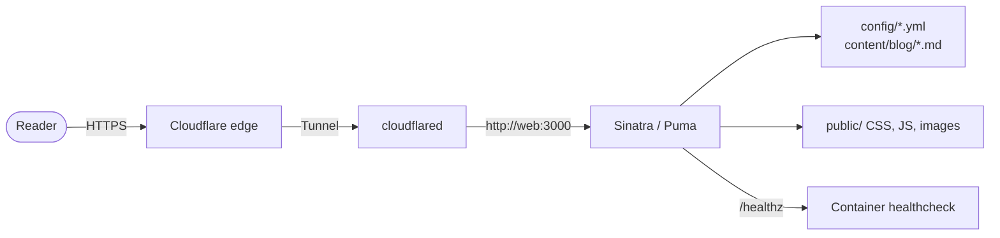

# Architecture

`shoutsid.fyi` is a small application with a deliberately narrow surface. This
page describes how a request becomes a page, where content lives, and which
parts of the design are load-bearing rather than incidental.

## System context



There is one application process, one content store and one outbound tunnel.
There is no database, no cache server, no background worker and no write path.

## Request lifecycle

1. **Cloudflare** terminates TLS and forwards the request through the tunnel.
   The apex and `www` are proxied CNAMEs pointing at the tunnel.
2. **`cloudflared`** receives the request and forwards it to
   `http://web:3000` on the Compose network. It never leaves the machine, so
   the origin is not publicly reachable at any point.
3. **Puma** accepts the request and calls the Rack app in `config.ru`.
4. **`CachePolicy` middleware** wraps the app and sets `Cache-Control` on every
   response, including static files.
5. **Sinatra** matches a route in `app.rb`, or serves a static file from
   `public/`. Static dispatch happens before `before` filters run.
6. **Helpers** read the content store, build canonical URLs, choose status
   labels and render page copy.
7. **ERB** renders the view with escaping on. Raw output is limited to
   embedding already-rendered HTML: `yield`, the header, footer and project-card
   partials, and rendered Markdown.
8. **`before` filters** add the security headers to generated responses.

## Routes

| Route | Renders |
|---|---|
| `GET /` | Homepage: hero, selected work, experience, systems/research, archive, latest posts, contact CTA |
| `GET /about` | Full experience, education, toolkit and working principles |
| `GET /work` | Every project, grouped by `section` |
| `GET /work/:slug` | A project case study |
| `GET /blog` | Post index |
| `GET /blog/feed.xml` | Atom feed, newest 20 posts |
| `GET /blog/:slug` | A post |
| `GET /contact` | Contact details and public profiles |
| `GET /cv` | Printable CV generated from the same content store |
| `GET /healthz` | JSON health and content counts |
| `GET /sitemap.xml` | Sitemap of pages, projects and posts |
| anything else | `404` error page |

`/blog/feed.xml` is declared before `/blog/:slug` on purpose: Sinatra matches in
declaration order, and a `:slug` route registered first would swallow the feed.

Error handlers render `views/errors/404.erb` and `views/errors/500.erb` with a
status and a page title. In development, exceptions are raised instead so a
failure is impossible to miss.

## Content layer

`lib/content.rb` is the only reader of `config/*.yml` and `content/blog/*.md`.
It does four things:

1. **Loads** YAML safely (`YAML.safe_load_file`) and splits post front matter.
2. **Normalises** every record so templates can assume a shape. `links`,
   `stack`, `highlights` and `screenshots` are always arrays; optional `demo`
   is either a complete hash or `nil`.
3. **Caches** results, keyed on file mtime. In production the files never
   change, so this is one `stat` per request; in development an edit takes
   effect on the next refresh without a restart.
4. **Validates** the whole store through `Content.validate!`, called at boot in
   every environment except `test`.

Validation is a boot failure rather than a runtime fallback. It checks:

- required profile fields and absolute profile links;
- unique project slugs, known statuses and known sections;
- required project fields, links, demos and screenshot files;
- at least one featured project and at least one project in `main`;
- required page-copy keys and the shape of section links;
- unique post slugs, and a title, summary and non-empty body on every post;
- scalar-only list entries, so a YAML mapping cannot reach a card as a
  `Hash#inspect` string.

The section model is the reason the homepage and `/work` cannot disagree:
`section` is one field (`main`, `systems`, `archive`), both pages call
`projects_in_section`, and order within a section is file order. There is no
second ordering list.

## Templates and escaping

The app uses ERB through Tilt and Erubi with `set :erb, escape: true`. In
practice:

- `<%= %>` escapes by default and is used everywhere.
- `<%== %>` is reserved for embedding already-rendered HTML: `yield`, the
  header, footer and project-card partials, and rendered Markdown. Adding
  another use is a decision, not a convenience.
- `erubi` is a direct dependency in the `Gemfile`. Without it, Tilt falls back
  to stdlib ERB, which ignores the escaping option and does not support the raw
  output tag at all. That fallback shipped as two live bugs before it was
  traced.

Templates carry no prose of their own. Page and section copy lives in
`config/pages.yml` and is rendered through `page_copy`, so a sentence describing
the content sits beside the content it describes. `site_integrity_spec.rb` fails
on a template containing a literal run of six or more words.

## Static assets and caching

`public/` is served directly; there is no asset pipeline. `asset_path` appends
the file's own digest to CSS and JavaScript URLs:

```text
/css/site.css?v=2f9c1a4e
```

`lib/cache_policy.rb` is middleware, not a `before` filter, because Sinatra
serves a static file before filters run and the served file halts. A filter
would set a header on every page and no asset — the exact wrong half.

| URL class | Policy |
|---|---|
| `/css/*`, `/js/*` with the current digest in `?v=` | `public, immutable, max-age=31536000` |
| The same file without a current digest | `public, no-cache` |
| Other files under `public/`, including screenshots and diagrams | `public, max-age=3600` |
| Generated pages, feed, sitemap and `/healthz` | `public, no-cache` |

The digest is checked against the file on disk, not merely parsed from the
query. Sinatra's static server ignores the query string, so
`/css/site.css?v=old` serves today's file; promising a year of immutability for
a URL that does not identify its content is the one thing this policy must not
do.

## Security headers

Every generated response carries:

| Header | Value |
|---|---|
| `Content-Security-Policy` | `default-src 'self'; base-uri 'none'; form-action 'none'; frame-ancestors 'none'; object-src 'none'; img-src 'self' data:; style-src 'self'; script-src 'self'; font-src 'self'; connect-src 'self'` |
| `X-Content-Type-Options` | `nosniff` |
| `X-Frame-Options` | `DENY` |
| `Referrer-Policy` | `strict-origin-when-cross-origin` |
| `Permissions-Policy` | geolocation, microphone, camera and interest-cohort disabled |

The CSP allows no inline scripts, so the theme is applied by an external
`/js/theme-boot.js` loaded before the stylesheet. Both theme icons are in the
markup and CSS chooses which one to show, so the first paint is correct with
JavaScript disabled as well.

## Container image

The Dockerfile has five stages:

| Stage | Purpose |
|---|---|
| `base` | Pinned Ruby image, locale, Bundler settings, workdir |
| `lock` | Resolves `Gemfile` into `Gemfile.lock`; used by `bin/site lock` |
| `dev` | Ruby toolchain and gems, **no source**; used by `check\|test\|lint\|shell` |
| `build` | Installs production gems and removes build artefacts |
| `runtime` | Copies the gems and the source, then drops privileges |

The base image is pinned by digest, not by tag, so a rebuild months later is the
same runtime. The runtime stage has no compiler: Puma's extension is built in
`build` and only the installed bundle is copied forward.

The runtime container:

- runs as uid 10001 with no interactive shell and no writable home directory;
- has a read-only root filesystem and a 16 MB `tmpfs` for `/tmp`;
- drops all capabilities and sets `no-new-privileges`;
- is limited to 256 MB and 0.5 CPU;
- carries its own `HEALTHCHECK`, so a bare `docker run` gets the same check as
  Compose.

## The tunnel overlay

`docker-compose.tunnel.yml` is layered on only when a public edge is wanted. It
adds one `cloudflared` container with:

- the same digest pinning and hardening as the app;
- a `depends_on` on the app's healthcheck, so no traffic arrives before the site
  answers;
- a remotely-managed tunnel token and no config file or credentials mount;
- bounded logs, a 128 MB limit and 0.25 CPU.

The tunnel token is marked required (`:?`) in the overlay, not the base file.
Keeping it there means the hard failure lands exactly where it is useful,
without blocking `docker compose build` or local commands before the tunnel has
been provisioned.

## Health and observability

`GET /healthz` returns:

```json
{
  "status": "ok",
  "service": "shoutsid-fyi",
  "version": "0.1.0",
  "uptime_seconds": 42,
  "projects": 9,
  "posts": 4
}
```

The project and post counts come from the same content store the pages read, so
a container that cannot read its content is reported unhealthy rather than
serving empty cards. The container healthcheck calls this endpoint; the tunnel
waits for the container to be healthy before starting.

Logs go to stdout and are collected by the `json-file` driver, bounded at
10 MB × 3 files. There is no application log file: the root filesystem is
read-only and the container is the unit of lifecycle.

## Trade-offs

| Decision | Cost | Why it is worth it |
|---|---|---|
| Content in YAML/Markdown, not a CMS | Editing means a commit and a deploy | No database, no auth, no write path, and content is reviewable in a diff |
| No JavaScript framework | No client-side routing or rich interactivity | Pages are static HTML, fast, and work without JavaScript |
| One application process | No horizontal scaling inside the container | The workload is template rendering; threads are enough and the content cache is not duplicated |
| Boot-time validation | A content typo stops the container | A broken card or missing figure is caught before a reader sees it |
| A dedicated tunnel per site | More setup than sharing one | One site's watchdog cannot take another site down |
| Hand-written CSS | No utility framework or preprocessor | The stylesheet is small, explicit and has no build step |
