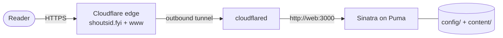

# Deployment

The site is published through a Cloudflare Tunnel. Compose publishes the app on
host loopback only; inside the private Compose network the app listens on
`0.0.0.0:3000` so `cloudflared` can reach it. There is no publicly reachable
origin port, no certificate to renew and no reverse proxy to keep patched.



## Prerequisites

- Docker Engine or Desktop with Compose v2.
- `curl` and `python3` on the host.
- `shoutsid.fyi` delegated to Cloudflare (its nameservers are
  `liv.ns.cloudflare.com` and `pablo.ns.cloudflare.com`).
- A scoped Cloudflare API token for the one-time setup.

### Token scopes

Create a custom token at **Cloudflare dashboard → My Profile → API Tokens →
Create Custom Token** with exactly:

| Scope | Permission |
|---|---|
| Account | Cloudflare Tunnel | Edit |
| Zone | DNS | Edit |
| Zone | Zone | Read |

Do not use the Global API Key. Revoke or rotate the token after provisioning if
you do not expect to re-run `cf-setup`.

## One-time provisioning

```bash
bin/site setup

CF_API_TOKEN=<token> bin/site cf-setup --dry-run   # inspect the plan
CF_API_TOKEN=<token> bin/site cf-setup             # apply
```

`cf-setup` is idempotent and safe to re-run. It:

1. verifies the token, or falls back to a zone lookup for a zone-scoped token;
2. resolves the zone and account;
3. creates a dedicated tunnel named `shoutsid-fyi`, or reuses it;
4. sets remotely-managed ingress for `shoutsid.fyi` and `www.shoutsid.fyi`,
   forwarding to `http://web:3000`, with an `http_status:404` catch-all;
5. creates or updates proxied CNAME records for the apex and `www` pointing at
   `<tunnel-id>.cfargotunnel.com`;
6. fetches the tunnel token and writes `CF_TUNNEL_TOKEN` into `.env` (mode
   600).

It does not deploy the site and does not need Docker.

### Why a dedicated tunnel

The existing `webcap` tunnel is run from the host under its own cron watchdog.
Joining it would make this site's uptime a function of that project's process.
One tunnel per site means one site's watchdog cannot take the other down.

## Every deploy

```bash
bin/site deploy
```

`deploy` performs these steps in order:

1. builds the production image (`--no-build` skips this);
2. starts `web` and `cloudflared` (`--no-tunnel` starts the site only);
3. polls `/healthz` for up to 45 seconds;
4. runs `verify --local`, which checks every page and a 404;
5. polls the public health endpoint for up to 60 seconds;
6. runs `verify --public` through `PUBLIC_URL` (default
   `https://shoutsid.fyi`).

If the public URL does not answer within 60 seconds, `deploy` says so and
leaves the local site running. A newly created DNS record can take a few
minutes to resolve; the local site being healthy means the problem is the edge,
not the application.

### Other ways in

```bash
bin/site deploy --no-build     # restart without rebuilding
bin/site deploy --no-tunnel    # local only
bin/site build                 # build only
bin/site up --tunnel           # start the stack without the full deploy checks
bin/site restart               # restart and wait for health
```

## Verifying a deployment

```bash
bin/site health                 # the app's own /healthz response
bin/site verify --local         # every page over loopback
bin/site verify --public        # every page through the tunnel
bin/site links                  # external URLs in config/ and content/
```

`verify` checks status codes and content: the homepage must name James
Summerill, because a 200 with an empty shell is the failure it exists to catch.
`links` is separate because it needs the network, which `check` deliberately
does not.

## Tunnel operations

```bash
bin/site tunnel status    # container state and the last 15 log lines
bin/site tunnel logs      # follow the tunnel logs
bin/site tunnel restart
bin/site tunnel down
bin/site tunnel up
```

The tunnel container is hardened like the app: read-only root, all capabilities
dropped, `no-new-privileges`, 128 MB and 0.25 CPU. It starts only after the app
reports healthy.

### Exactly one connector

A second `cloudflared` registered against the same tunnel breaks the site
**intermittently**, not completely. Requests are load-balanced across every
connector, so a stray connector — a leftover `docker run` probe, for example,
sitting on the default `bridge` network where `web` does not resolve — makes
roughly every other request fail with a 502 while the good connector serves the
rest.

Check the tunnel's connections in the Cloudflare API:

```text
GET /accounts/{account_id}/cfd_tunnel/{tunnel_id}/connections
```

Exactly one connection is correct. A stopped connector lingers there until
Cloudflare's heartbeat timeout, so confirm the count drops to one rather than
assuming `docker rm` was enough.

## Rollback

There is no registry, blue-green deployment or automated rollback. The image is
built locally and tagged `shoutsid-fyi-web:latest`.

A simple rollback is to keep the previous image before a deploy:

```bash
docker tag shoutsid-fyi-web:latest shoutsid-fyi-web:previous   # before deploy
bin/site deploy
```

If the new version is wrong:

```bash
docker tag shoutsid-fyi-web:previous shoutsid-fyi-web:latest
bin/site up          # no rebuild; a running tunnel reconnects
bin/site verify
```

If the tunnel also needs restarting, use `bin/site up --tunnel` instead.

For a change that needs a code rollback, check out the last good commit,
rebuild and deploy:

```bash
git checkout <good-sha>
bin/site deploy
```

Content is baked into the image, so reverting a content file also requires a
rebuild. A stale image is the usual reason a new page or post 404s after a
deploy.

## DNS and certificates

- The apex and `www` are proxied CNAME records pointing at the tunnel.
- Cloudflare terminates TLS and issues the certificate; there is nothing to
  renew on this host.
- Verify records with `dig +short shoutsid.fyi` and
  `dig +short www.shoutsid.fyi`; both should return Cloudflare addresses.
- A newly created record can take a few minutes to resolve. `deploy` tolerates
  this for 60 seconds and then reports it.

## Refreshing or rotating the tunnel token

`CF_TUNNEL_TOKEN` is the only secret the running deployment holds. If `.env` has
lost it, re-run `CF_API_TOKEN=<token> bin/site cf-setup`; the script fetches the
existing tunnel's token and rewrites the line. That refreshes the value but does
not rotate the credential.

To rotate it, create a new tunnel and point the DNS records at it:

```bash
CF_TUNNEL_NAME=shoutsid-fyi-2 \
CF_API_TOKEN=<token> \
bin/site cf-setup
bin/site tunnel restart
```

`cf-setup` updates the ingress and the existing CNAME records to the new tunnel,
so the old connector can be removed once the new one is healthy. Confirm one
connector and a healthy public URL afterwards.

## Deployment checklist

Before a deploy:

- [ ] `bin/site check` passes.
- [ ] `bin/site links` passes.
- [ ] Content changes have been read against the editorial rules.
- [ ] A figure added to a case study exists under `public/`.
- [ ] The version in `.env` matches `.env.example` if it changed.

After a deploy:

- [ ] `bin/site health` reports the expected version and content counts.
- [ ] `bin/site verify --public` passes.
- [ ] `bin/site tunnel status` shows one healthy connector.
- [ ] A newly added project or post is reachable at its URL.

## Troubleshooting

See [Troubleshooting](troubleshooting.md) for port conflicts, file sharing,
locale failures, tunnel flapping and the "new page 404s" case.
